# 일레븐랩스(ElevenLabs) 시작하기

글을 넣으면 사람 목소리로 읽어 주는 AI 서비스, 일레븐랩스의 가입과 기초 사용법을 정리했습니다.

- 화면 기준일: 2026년 11월 21일 (한국어 화면)
- 화면은 자주 바뀝니다. 메뉴 위치가 다르면 비슷한 이름을 찾아 주세요.
- 캡처에서 흐리게 처리한 부분은 개인 정보(계정 이름, 남은 크레딧, 작성 중이던 원고)입니다.

## 목차

1. [가입하기](#1-가입하기)
2. [텍스트 음성 변환: 글을 목소리로 바꾸기](#2-텍스트-음성-변환-글을-목소리로-바꾸기)
3. [목소리 찾기와 만들기](#3-목소리-찾기와-만들기)
4. [알아 두면 좋은 점](#4-알아-두면-좋은-점)

---

## 1. 가입하기

### 1-1. 홈페이지에서 [회원가입] 누르기

`elevenlabs.io`에 들어가면 첫 화면 왼쪽 위에 **[회원가입]** 버튼이 있습니다. 오른쪽 위 **[로그인]** 은 이미 계정이 있을 때 씁니다.

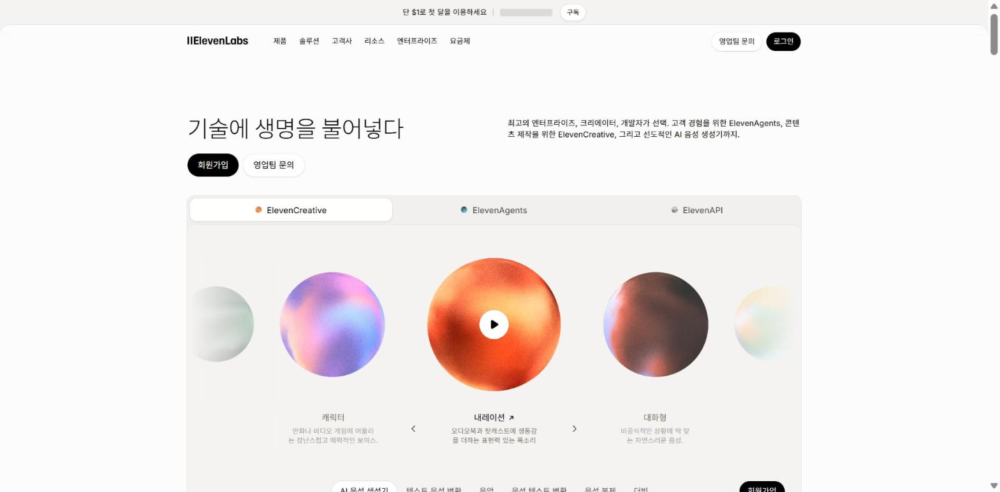

### 1-2. 가입 방법 고르기

가입 화면에서 세 가지 중 하나를 고릅니다.

- **Google로 가입하기**: 구글 계정으로 바로 가입합니다. 가장 간단합니다.
- **SSO로 가입하기**: 회사 통합 로그인을 쓰는 경우입니다. 개인은 쓸 일이 거의 없습니다.
- **이메일 + 비밀번호**: 이메일과 비밀번호를 적고, 약관 동의에 체크한 뒤 **[가입하기]** 를 누릅니다.

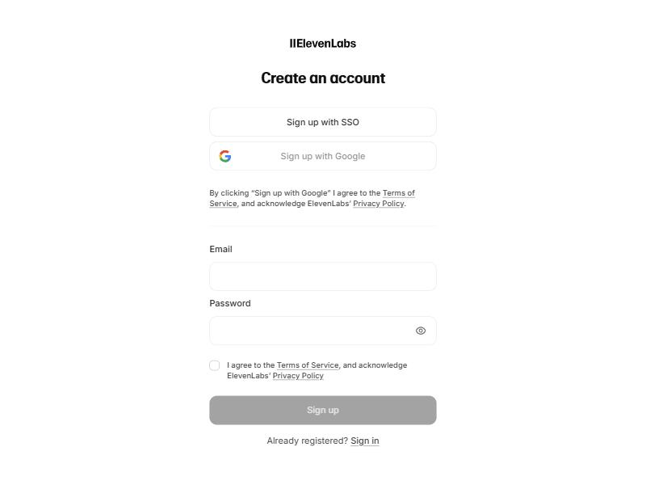

> 위 캡처는 로그인하지 않은 브라우저에서 찍어 영어로 나왔습니다. 한국어 화면에서는 "계정 생성하기", "SSO로 가입하기", "Google로 가입하기", "이메일", "비밀번호", "가입하기"로 보입니다.
>
> 이메일로 가입한 뒤 확인 메일이 오는지, 처음 들어갈 때 어떤 질문이 나오는지는 새 계정을 만들지 않아 확인하지 못했습니다. (확인 필요)

### 1-3. 가입 후 첫 화면

가입하고 로그인하면 아래 홈 화면이 나옵니다. 왼쪽 메뉴에서 기능을 고릅니다.

- **음성**: 목소리 모음(Voice Library)
- **텍스트 음성 변환**: 글을 목소리로 바꾸기 (가장 많이 쓰는 기능)
- **음성 생성**: 내 목소리 복제, 새 목소리 디자인

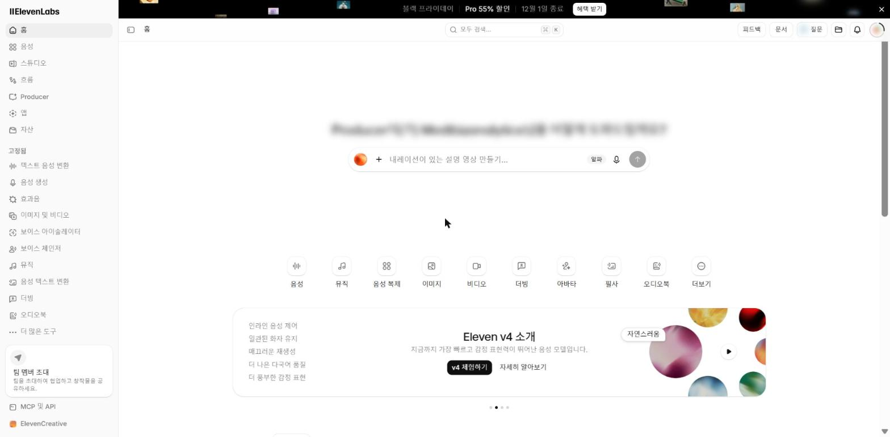

---

## 2. 텍스트 음성 변환: 글을 목소리로 바꾸기

### 2-1. 화면 열기

왼쪽 메뉴에서 **[텍스트 음성 변환]** 을 누릅니다.

- 가운데 큰 칸: 읽힐 글을 적는 곳
- 아래 오른쪽 **[음성 생성]** 버튼: 목소리 만들기
- 아래 가운데 "521 / 100,000 문자": 지금 글자 수 / 한 번에 넣을 수 있는 최대 글자 수
- 오른쪽 **[기록]** 탭: 전에 만든 음성 목록

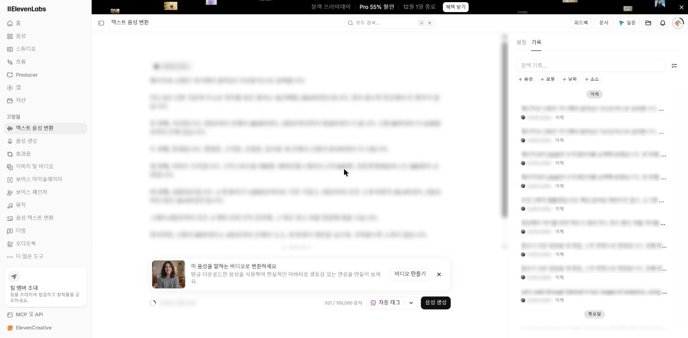

### 2-2. 설정 확인하기

오른쪽 위 **[설정]** 탭을 누르면 다음 항목이 보입니다.

| 항목 | 뜻 |
|---|---|
| 음성 | 어떤 목소리로 읽을지 |
| 모델 | 음성 엔진 (캡처 시점 기본값: Eleven v4) |
| 안정성 | 왼쪽 "창의적인" ↔ 오른쪽 "견고한". 오른쪽일수록 매번 비슷하게 읽음 |
| 유사성 | 원래 목소리와 얼마나 닮게 할지 (낮음 ↔ 높음) |
| 언어 | 기본 "자동" |
| 출력 형식 | 내려받을 파일 형식 (캡처 시점: MP3 44.1 kHz (128kbps)) |

처음에는 **음성**만 고르고 나머지는 그대로 두어도 됩니다.

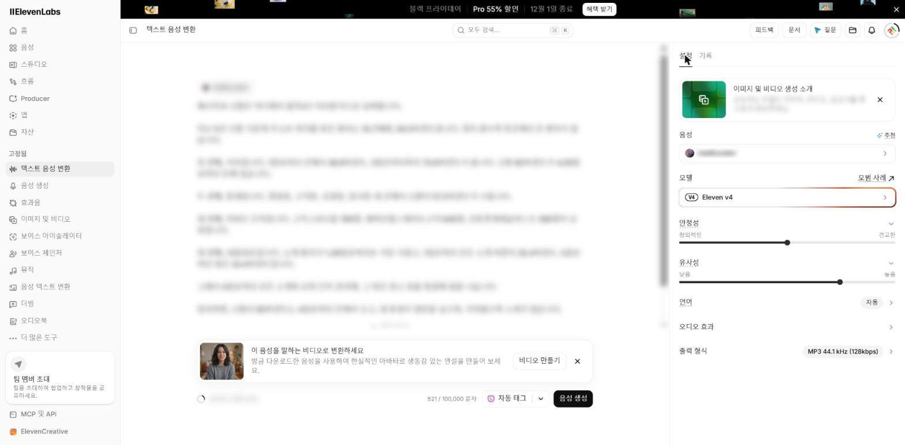

### 2-3. 목소리 고르기

1. 설정 탭의 **음성** 칸을 누릅니다.
2. 목소리 고르기 창이 열립니다. 위쪽 **[탐색]** 은 전체 목소리, **[내 음성]** 은 내가 추가하거나 만든 목소리입니다.

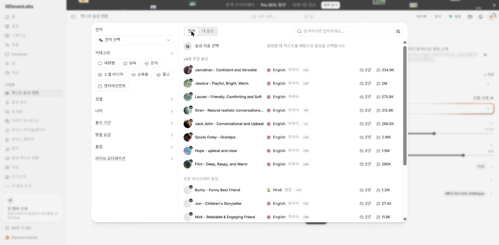

3. 왼쪽 **언어 → 언어 선택**에서 `Korean`을 고르면 한국어 목소리만 남습니다. 옆 **악센트 선택**에서 서울, 표준, 경상, 전라도, 충청, 함경 같은 말투도 고를 수 있습니다.
4. 목록에서 목소리 줄을 누르면 아래쪽에서 **미리 듣기**가 재생됩니다.
5. 마음에 들면 그 줄 오른쪽의 **[사용]** 을 누릅니다. ([추가]는 "내 음성"에 담아 두는 버튼입니다.)

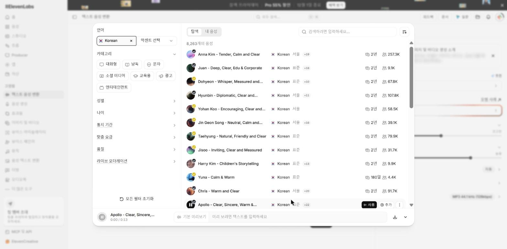

### 2-4. 글 넣고 음성 만들기

1. 가운데 큰 칸을 누르고 읽힐 글을 적습니다. 글 위에 지금 고른 목소리 이름이 표시됩니다.
2. 아래쪽 글자 수가 바뀌었는지 확인합니다. (예: "23 / 100,000 문자")
3. 오른쪽 아래 **[음성 생성]** 을 누릅니다. 단축키는 `Ctrl+Enter`입니다.

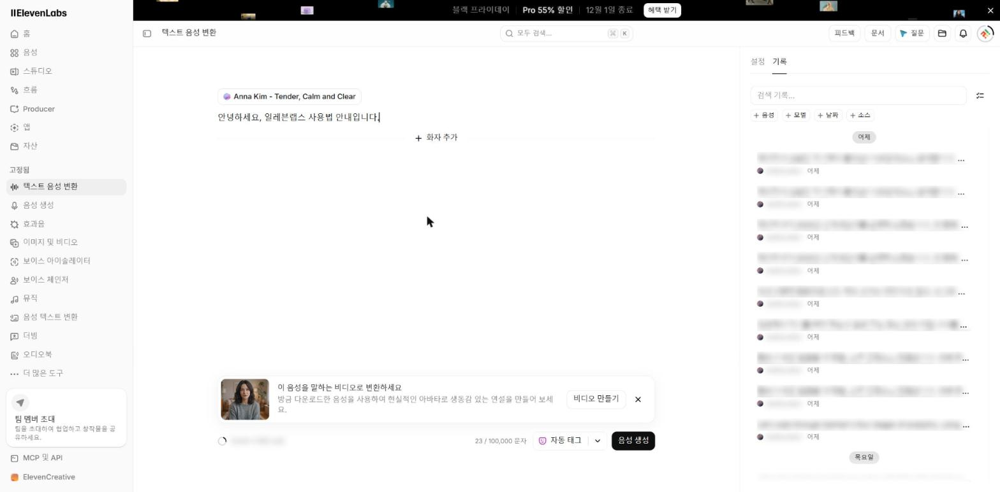

> 시험 결과: 23자 한 문장을 만드는 데 크레딧 23이 줄었습니다. (모델 Eleven v4, 2026-11-21 기준)

### 2-5. 듣기와 내려받기

생성이 끝나면 화면이 이렇게 바뀝니다.

- 글 아래에 **세대 1**, **세대 2** 두 가지 버전이 나옵니다. 한 번 누르면 두 버전이 함께 만들어집니다. 버전마다 ▶ 재생, 좋아요/싫어요, 내려받기 아이콘이 있습니다.
- 화면 맨 아래에 재생 막대가 생깁니다. 가운데 **재생** 버튼, 양옆에 **10초 되감기**와 **10초 앞으로 건너뛰기**, 맨 오른쪽에 **오디오 다운로드** 버튼이 있습니다.
- 내려받으면 설정 탭의 **출력 형식**(캡처 시점 MP3) 파일로 저장됩니다. 실제로 내려받지는 않았습니다. 파일 이름이 어떻게 붙는지는 확인 필요.
- **[음성 생성]** 버튼은 **[음성 다시 생성]** 으로 바뀝니다. 다시 누르면 크레딧이 또 줄어듭니다.
- 오른쪽 **[기록]** 탭에도 방금 만든 음성이 맨 위에 쌓입니다. 나중에 여기서 다시 듣거나 내려받을 수 있습니다.

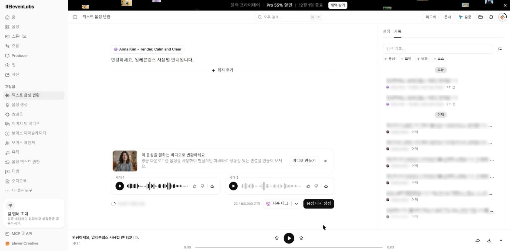

---

## 3. 목소리 찾기와 만들기

### 3-1. 목소리 모음 보기 (Voice Library)

왼쪽 메뉴 **[음성]** 을 누르면 목소리 모음이 열립니다.

- 검색창에 "라이브러리 음성 검색..."이라고 적혀 있습니다. 이름이나 특징으로 찾습니다.
- **언어**, **대화형 / 낭독 / 문자 / 소셜 미디어 / 교육용 / 광고 / 엔터테인먼트** 버튼으로 용도별로 좁힐 수 있습니다.
- **[내 음성]** 탭에는 내가 담아 두거나 만든 목소리가 모입니다.

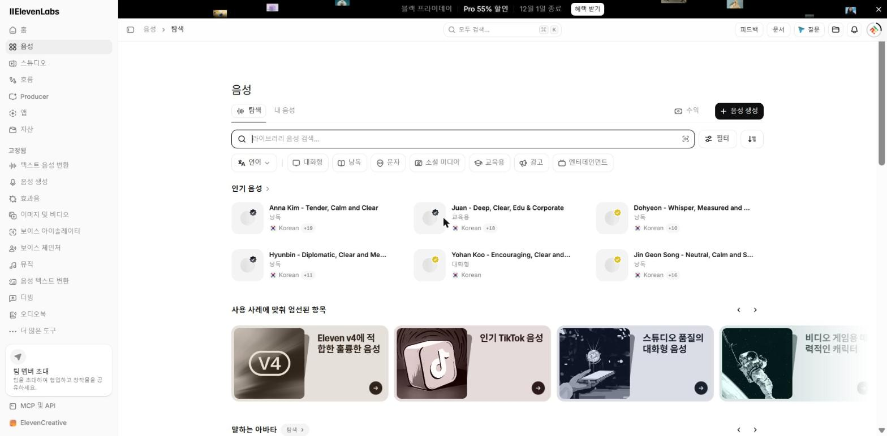

### 3-2. 새 목소리 만들기 메뉴

음성 화면 오른쪽 위 **[+ 음성 생성]** 을 누르거나, 왼쪽 메뉴 **[음성 생성]** 을 누르면 아래 화면이 나옵니다.

| 메뉴 | 하는 일 | 캡처 시점 상태 |
|---|---|---|
| 즉시 음성 복제 | 10초~3분 분량 녹음으로 내 목소리 복제 | [새로 만들기] 가능 |
| 프로페셔널 음성 복제 | 30분 이상 녹음으로 더 정교하게 복제 (최소 10분, 최고 2시간) | "생성하려면 업그레이드" (상위 요금제 필요) |
| 보이스 디자인 | 글로 설명해서 새 목소리 만들기 | [새로 만들기] 가능 |
| 음성 리믹싱 (기타 도구) | 기존 목소리의 피치·속도 등을 바꿔 새 목소리 만들기 | [새로 만들기] 가능 |

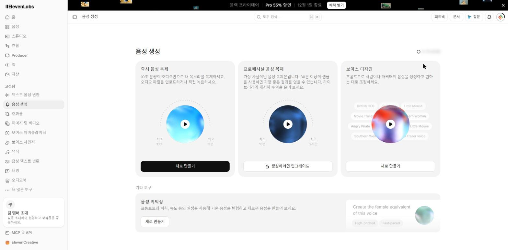

### 3-3. 보이스 디자인 (Voice Design)

**보이스 디자인 → [새로 만들기]** 를 누르면 창이 열립니다.

1. **프롬프트** 칸에 원하는 목소리를 글로 적습니다. 예시 문장이 미리 들어 있습니다(영어).
2. 아래 "Evil Ogre", "Little Mouse", "Southern Woman" 같은 버튼을 누르면 예시 프롬프트가 바뀝니다.
3. **[음성 생성]** 을 누르면 목소리 후보가 만들어집니다. 버튼 옆 숫자(캡처 시점 171)는 쓰이는 크레딧입니다.

> 이 설명서를 만들 때는 크레딧을 아끼려고 보이스 디자인의 [음성 생성]은 누르지 않았습니다. 생성 뒤 화면은 확인 필요.

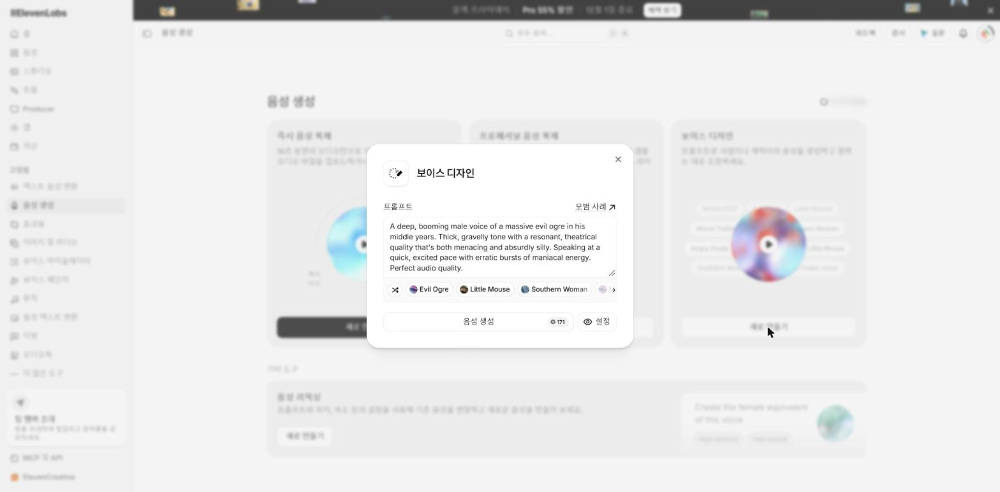

### 3-4. 즉시 음성 복제 (내 목소리 복제)

**즉시 음성 복제 → [새로 만들기]** 를 누르면 아래 화면이 나옵니다.

- **[파일 업로드]**: 녹음해 둔 파일을 올립니다. 파일당 최대 10MB.
- **[오디오 녹음]**: 마이크로 바로 녹음합니다.
- 오른쪽 안내대로 최소 10초, 품질을 높이려면 3분 분량을 권합니다.

> 본인 목소리나 동의받은 목소리만 복제하세요. 업로드 뒤 단계는 시험하지 않았습니다. (확인 필요)

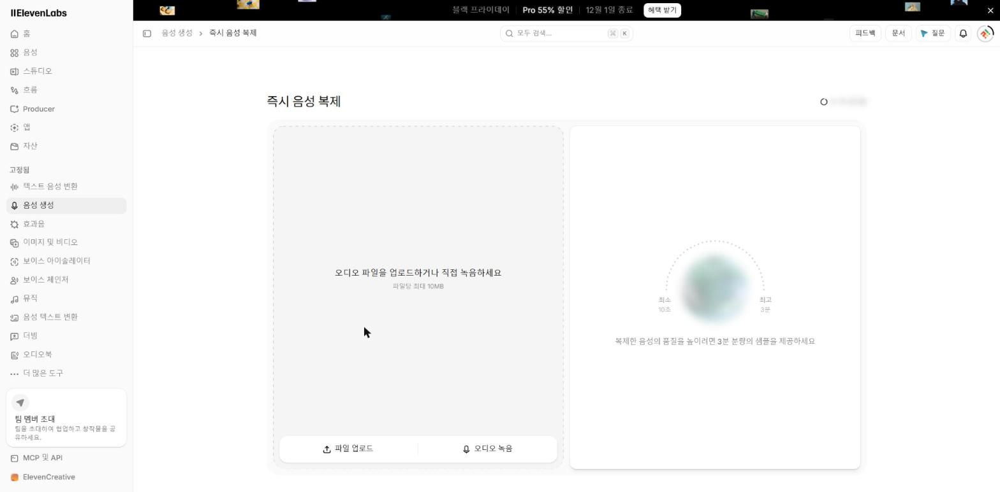

---

## 4. 알아 두면 좋은 점

- **크레딧**: 음성을 만들 때마다 크레딧이 줄어듭니다. 시험해 보니 23자에 23 크레딧, 즉 글자당 1 크레딧이었습니다(Eleven v4 기준, 다른 모델은 확인 필요). 남은 크레딧은 텍스트 음성 변환 화면 왼쪽 아래에 "○○ 크레딧 남음"으로 보입니다.
- **미리 듣기**는 목소리를 고를 때 쓰는 기본 샘플이라, 목소리 고르기 단계에서는 크레딧이 줄지 않는 것으로 보입니다. (확인 필요)
- **API 키**: 왼쪽 아래 **[MCP 및 API]** 메뉴는 개발자용입니다. 키는 비밀번호와 같으니 화면 캡처나 문서에 절대 넣지 마세요.
- 화면 맨 위의 할인 배너(블랙 프라이데이 등)는 시기마다 바뀌는 광고입니다.
